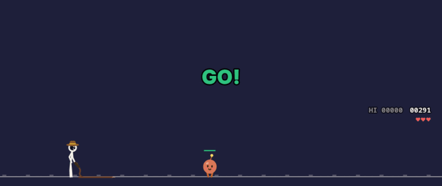

# Whip Run: Whip Claude Into Shape

Claude Code is thinking. You are staring at a spinner. Whip Run turns the bottom edge of your real screen into an endless-runner track: a cowboy sprints along your taskbar, jumps bugs, smashes 500 errors, and keeps Claude running with a well-timed crack of the whip. Press `Ctrl+Alt+J` to play, and press it again to get your screen back.

## How to Play

Press `Ctrl+Alt+J` (`Cmd+Alt+J` on macOS) or click **🤠 Whip Run** in the status bar. The cowboy drops in from the sky and starts running. Your mouse keeps working the whole time, because the game is click-through:

| Key | Does |
| --- | --- |
| `Space` or `↑` | Jump. Tap for a hop, hold for a big jump |
| `↓` | Duck under flying bugs |
| `Enter` | Crack the whip. It aims itself at the nearest target |
| `Esc` or `Ctrl+Alt+J` | Stop. Everything vanishes in a puff of smoke |

## What's on the Track

Every level runs faster and adds something new, from **Hello World** through **Stack Overflow**, **Merge Conflict**, **Prod Is Down** and **Friday Deploy** to **Infinite Loop**:

- **🐞 Bugs**: crawl along the floor. Whip them or jump them
- **🪰 Flying bugs**: arrive at head height. Duck, jump or whip
- **📦 500 Error crates**: smash them for points
- **🔺 Failing tests**: can't be whipped. Jump
- **😴 Slacking bots**: whip them awake for bonus points, or trip over them
- **🪙 Tokens**: float above the track in arcs. Jump to collect

You get 3 lives, combos up to x5, and your best score is saved.

## Keep Claude Running

Claude runs ahead of you with a small energy bar over his head. The energy drains, and a tired Claude drifts back toward you, mumbling about coffee. Once he's in reach, crack the whip: he yells "You're absolutely right!", sprints ahead, and your points double for 4 seconds. Let him fall asleep and you lose a life.

## Connect to Claude Code

Run **Whip Run: Connect to Claude Code** from the Command Palette. Whip Run adds 5 small hooks to `~/.claude/settings.json` (after asking, and after saving a backup) so the game knows what Claude Code is doing:

- **While Claude Code works** (opt-in, turn on `whipRun.reactToClaude`): your screen reacts to each tool. File edits fly past as paper airplanes, commands pop up on a sign, and searches sweep by under a magnifying glass. After 20 seconds the cowboy starts dropping by on his own. `Esc` sends everyone home
- **While you play**: every file Claude edits sends a fresh bug down your track
- **When Claude Code finishes**: you get a **DONE ✅** sign and +100 points

The hooks record only the tool name plus a filename, command or search pattern, in `~/.whip-run`. They never record your prompts or file contents. The hooks need Node.js on your `PATH`. **Whip Run: Disconnect from Claude Code** removes them.

## Requirements

Whip Run draws on top of your screen with Electron. On first play it asks to download Electron once (about 100 MB) from GitHub, checks it against Electron's published SHA-256 checksums, and stores it in VS Code's extension storage. To use an Electron you already have, set `whipRun.electronPath`.

| System | Status |
| --- | --- |
| Linux with X11 | Fully supported. The cowboy can even land on top of your focused window |
| Linux with Wayland | Runs through XWayland |
| macOS and Windows | Supported. The cowboy stays on the bottom of the screen |

## Settings

| Setting | Default | Does |
| --- | --- | --- |
| `whipRun.reactToClaude` | `false` | Let the overlay pop up on its own while Claude Code works |
| `whipRun.cameoAfterSeconds` | `20` | Seconds of Claude Code work before the cowboy visits on his own |
| `whipRun.notifyWhenDone` | `true` | Notify you when Claude Code finishes or needs input |
| `whipRun.sound` | `true` | Whip cracks, yelps and jingles |
| `whipRun.electronPath` | empty | Use this Electron instead of downloading one |

`Ctrl+Alt+Q` closes the overlay completely, from anywhere.

Whip Run is a fan-made game and isn't affiliated with or endorsed by Anthropic. No AIs were harmed in the making of this extension. Claude was mildly inconvenienced.
